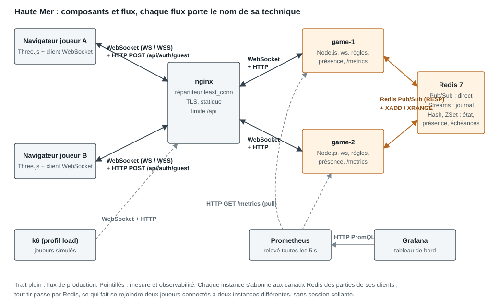

# Architecture

## Composants

| Composant | Rôle | État conservé |
|---|---|---|
| Navigateur | Rendu 3D, saisie, reconnexion, dédoublonnage | Sessions (`localStorage`, une par onglet grâce à un verrou Web Locks), dernier `seq` reçu, commandes non acquittées |
| nginx (`lb`) | Répartition `least_conn`, TLS, statique, limite sur `/api`, en-têtes de sécurité | Aucun |
| `game-1`, `game-2` | Passerelle WebSocket et logique métier : authentification, validation, règles, présence, métriques | Connexions ouvertes uniquement |
| Redis | Broker et état partagé | Parties, journal, présence, file d'attente, échéances |
| Prometheus, Grafana | Collecte et tableau de bord | Séries temporelles (2 jours) |
| k6 (profil `load`) | Joueurs simulés | Aucun |

Une instance ne garde **aucun état de partie en mémoire**. C'est ce qui permet à un client de se reconnecter sur l'autre instance sans session collante.

## Flux

| # | De → vers | Technique | Contenu |
|---|---|---|---|
| 1 | Navigateur → nginx → instance | HTTP (POST `/api/auth/guest`) | Échange d'un indicatif contre un JWT |
| 2 | Navigateur ↔ nginx ↔ instance | **WebSocket** (WS, ou WSS par le port 8443) | Commandes, événements, présence, battements |
| 3 | Instance → Redis | Script Lua atomique | Compare-and-set, écriture du journal, publication |
| 4 | Redis → instances | **Redis Pub/Sub** | Événements de partie, messages par joueur, présence |
| 5 | Instance → Redis | **Redis Streams** (`XRANGE`) | Rejeu des événements manqués à la reprise |
| 6 | Prometheus → instances | HTTP pull (`/metrics`) | Métriques, sur le réseau interne uniquement |
| 7 | Grafana → Prometheus | HTTP (PromQL) | Requêtes du tableau de bord |
| 8 | k6 → nginx | WebSocket et HTTP | Charge simulée |

## Pourquoi deux joueurs sur deux instances se voient

Sans broker, une instance ne connaît que ses propres sockets : un tir reçu par `game-1` n'atteindrait jamais un joueur connecté à `game-2`. Ici, le tir suit toujours le même chemin, que les joueurs soient sur la même instance ou non :

1. `game-1` reçoit `game.fire`, valide le message et relit la partie dans Redis.
2. Les règles (fonctions pures de `shared/game.js`) produisent le nouvel état et l'événement `game.shot`.
3. Le script Lua vérifie que `seq` n'a pas bougé, écrit l'état, ajoute l'événement au Stream de la partie et le publie sur `bn:ch:game:<id>`, le tout de façon atomique.
4. Toute instance abonnée à ce canal, parce qu'elle sert un joueur de la partie, écrit l'événement sur les sockets concernées.

## Modèle de données Redis

| Clé | Type | Usage |
|---|---|---|
| `bn:game:<id>` | Hash `seq`, `state` | État autoritaire de la partie |
| `bn:game:<id>:log` | Stream, identifiants `0-<seq>` | Journal pour la reprise (2 000 entrées environ) |
| `bn:ch:game:<id>` | Canal Pub/Sub | Diffusion aux instances concernées |
| `bn:ch:user:<id>` | Canal Pub/Sub | Messages destinés à un joueur |
| `bn:ch:presence` | Canal Pub/Sub | Variations de présence |
| `bn:deadlines` | ZSet score = échéance | Délais de tour, balayés par toutes les instances |
| `bn:active:<userId>` | Chaîne | Partie en cours d'un joueur |
| `bn:cmd:<userId>:<id>` | Chaîne, 10 min | Idempotence des commandes |
| `bn:queue` | Liste | File d'appariement |
| `bn:room:<code>` | Chaîne, 10 min | Salon privé |
| `bn:presence:*` | ZSet + Hash | Connexions, compteurs, utilisateurs |
