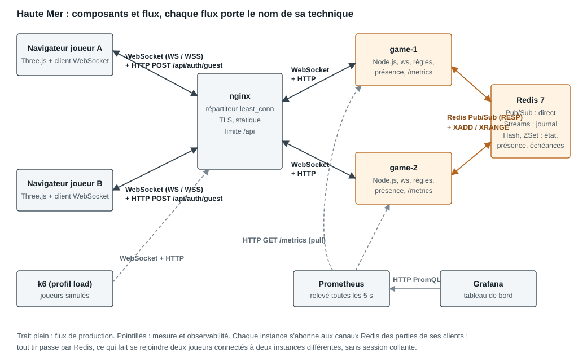
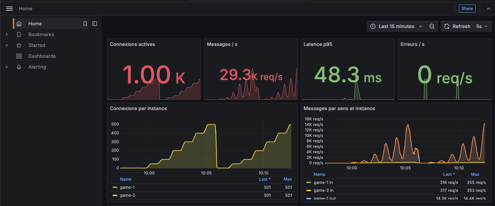
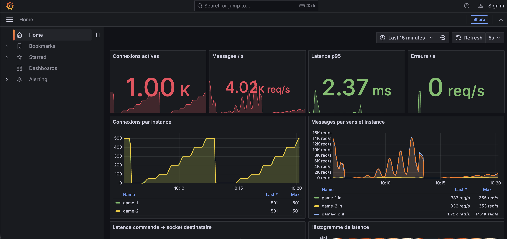

# 1. Contexte, utilisateurs, scénario principal

**Sujet.** *Haute Mer* est une bataille navale à deux joueurs, jouée dans le navigateur, dans une scène 3D. Chaque commandant déploie cinq navires sur une grille de 10 × 10, dont un porte-avions de 5 × 2 cases. Les joueurs tirent ensuite à tour de rôle : un joueur qui touche rejoue, et la partie s'arrête quand une flotte est entièrement coulée.

**Cadre.** Le sujet a été proposé par le groupe, comme la fiche l'autorise. Il relève du cadre AL, *plateforme orientée événements* : chaque tir, chaque changement de phase et chaque message de chat est un **événement numéroté, journalisé et diffusé**. Le client reconstruit l'état de la partie à partir de ces événements, et peut en rattraper le fil après une coupure. Le projet reprend aussi deux notions du cadre IW : les salons privés et la présence.

**Utilisateurs.** Des joueurs occasionnels qui veulent lancer une partie en quelques secondes, sans créer de compte, contre un adversaire aléatoire ou contre un proche grâce à un code de salon.

**Scénario principal**

1. Le joueur saisit son indicatif et voit qui est connecté.
2. Il cherche un adversaire, ou crée un salon dont il transmet le code.
3. Les deux joueurs déploient leur flotte (120 s au plus, placement aléatoire ensuite).
4. Ils tirent à tour de rôle : chaque tir apparaît chez l'adversaire en quelques millisecondes.
5. La dernière flotte coulée termine la partie ; une revanche peut être proposée.

**Lancement.** `docker compose up` démarre l'ensemble sur un poste où seul Docker est installé. Le jeu est servi sur `http://localhost:8088` (et en TLS sur le port 8443), Grafana sur le port 3001. **Aucune API payante ni donnée externe** n'est utilisée. Les seuls acteurs simulés sont les joueurs virtuels du test de charge, décrits en section 8.

# 2. Architecture



| Composant | Rôle | État conservé |
|---|---|---|
| Navigateur | Rendu 3D (Three.js), saisie, reconnexion, dédoublonnage | Session, dernier `seq` reçu, commandes non acquittées |
| nginx (`lb`) | Répartition `least_conn`, TLS, fichiers statiques, limite sur `/api`, en-têtes de sécurité | Aucun |
| `game-1`, `game-2` | Passerelle WebSocket et logique métier : authentification, validation, règles, présence, métriques | Connexions ouvertes uniquement |
| Redis 7.4 | Broker et état partagé | Parties, journal, présence, file d'attente, échéances |
| Prometheus, Grafana | Collecte et tableau de bord | Séries temporelles (2 jours) |
| k6 (profil `load`) | Joueurs simulés | Aucun |

| # | Flux | Technique | Contenu |
|---|---|---|---|
| 1 | Navigateur → nginx → instance | HTTP `POST /api/auth/guest` | Indicatif échangé contre un JWT |
| 2 | Navigateur ↔ nginx ↔ instance | **WebSocket** (WS, ou WSS sur 8443) | Commandes, événements, présence, battements |
| 3 | Instance → Redis | Script **Lua** atomique | Compare-and-set, écriture du journal, publication |
| 4 | Redis → instances | **Redis Pub/Sub** | Événements de partie, messages par joueur, présence |
| 5 | Instance → Redis | **Redis Streams** (`XRANGE`) | Rejeu des événements manqués |
| 6 | Prometheus → instances | HTTP pull `/metrics` | Métriques, sur le réseau interne |
| 7 | Grafana → Prometheus | HTTP (PromQL) | Requêtes du tableau de bord |
| 8 | k6 → nginx | WebSocket et HTTP | Charge simulée |

**Chemin d'un tir.** `game-1` reçoit `game.fire`, valide le message et relit la partie dans Redis. Les règles, des fonctions pures partagées avec le client (`shared/game.js`), produisent le nouvel état et l'événement `game.shot`. Un script Lua vérifie que le numéro de séquence `seq` n'a pas bougé, écrit l'état, ajoute l'événement au Stream de la partie et le publie sur `bn:ch:game:<id>`, en une seule opération atomique. Chaque instance abonnée à ce canal, parce qu'elle sert un joueur de la partie, écrit l'événement sur les sockets concernées. Le chemin est le même que les joueurs soient sur une seule instance ou sur deux.

**Aucun état de partie n'est gardé en mémoire dans une instance.** C'est ce qui permet à n'importe quelle instance de servir n'importe quel joueur, sans session collante, et à un client de se reconnecter sur l'autre instance en cas de panne.

# 3. Décisions et alternatives comparées

Chaque choix majeur est comparé à au moins deux alternatives. Le critère décisif est celui qui a tranché pour ce projet. Le tableau complet est dans `docs/decisions.md`.

| Décision | Retenu | Alternatives écartées | Critère décisif |
|---|---|---|---|
| Technique temps réel | **WebSocket** | SSE + POST (deux canaux) ; interrogation périodique (latence = période) | Trafic bidirectionnel fréquent sur un seul canal authentifié |
| Bibliothèque | **`ws`** | Socket.IO (protocole propre qui masque ce qu'il faut démontrer) ; uWebSockets.js (module natif) | Contrat visible tel quel dans l'onglet Réseau, garanties écrites par nos soins |
| Broker | **Redis Pub/Sub + Streams** | NATS JetStream (stockage d'état en plus) ; Kafka (exploitation lourde pour 8 Go de RAM) | Un seul composant pour la diffusion, le journal, l'état et la présence, avec un script Lua atomique |
| Garantie de livraison | **Au moins une fois + dédoublonnage par `seq`** | Au plus une fois (un tir perdu désynchronise la partie) ; « exactement une fois » de bout en bout (irréaliste) | Perdre un tir est inacceptable, un doublon est gérable |
| Concurrence entre instances | **Compare-and-set sur `seq` (Lua)** | Verrou distribué (attente, double détenteur) ; affinité partie → instance (panne difficile à absorber) | Toute instance sert tout joueur, sans verrou |
| Répartition | **nginx `least_conn`, sans session collante** | HAProxy (composant en plus) ; round-robin avec sessions collantes (inutile, l'état est dans Redis) | Un seul composant qui sert aussi le statique et le TLS ; rééquilibrage des connexions longues |
| Authentification | **JWT invité dans `Sec-WebSocket-Protocol`** | Jeton dans l'URL (fuite dans les journaux) ; premier message d'authentification (socket ouverte avant vérification) | Refus en HTTP 401 avant toute allocation |
| Validation | **JSON Schema + Ajv** | zod ; validation manuelle (oublis) | Le schéma valide et génère le contrat |
| Sérialisation | **JSON** | MessagePack (trames illisibles) ; Protobuf (génération de code) | Messages lisibles dans l'onglet Réseau ; le coût mesuré vient du nombre d'envois, pas de leur taille |
| Pile serveur | **Node.js 22** | Go (moins de code partagé) ; Elixir/Phoenix (compétence absente) | Règles partagées entre client et serveur |
| Outil de charge | **k6** | Artillery (partie à deux joueurs pénible en YAML) ; script maison (métriques à refaire) | Scénario en JS, image Docker, histogrammes par palier |
| Observabilité | **Prometheus + Grafana** | Journaux seuls (pas d'histogramme) ; service hébergé (payant ou externe) | Standard, provisionné dans Compose |
| Optimisation | **Regroupement de la présence** | `permessage-deflate` (mémoire et CPU par connexion) ; format binaire | Le coût est quadratique en nombre d'envois |

# 4. Contrat de messages

Le contrat complet est `docs/contrat-messages.md`. Il est **généré depuis le code** (`shared/protocol.js`), c'est-à-dire depuis les schémas que le serveur applique réellement. Un test unitaire valide chaque exemple, et le test de bout en bout compare les trames réelles d'une partie à ce contrat.

**Transport.** Point d'entrée `/ws`. Une trame texte contient un objet JSON, et les trames binaires sont refusées. La limite est de 4 096 octets par message et de 65 536 par trame. Le jeton est passé dans le sous-protocole `auth.<jeton>`, à côté de `bn.v1`, parce que l'API WebSocket du navigateur n'accepte pas d'en-tête `Authorization`.

| Famille | Sens | Enveloppe |
|---|---|---|
| Commande | client → serveur | `{ id, type, payload }` ; `id` est un UUID, clé d'idempotence |
| Message | serveur → client | `{ id, type, ts, payload }` |
| Événement de partie | serveur → client (Pub/Sub, journalisé en Stream) | `{ id, type, ts, gameId, seq, payload }` ; `seq` croît de 1 par partie |

| Sens | Types |
|---|---|
| Client → serveur (11) | `sys.ping`, `match.queue`, `match.cancel`, `room.create`, `room.join`, `game.resume`, `game.place`, `game.fire`, `game.forfeit`, `game.rematch`, `chat.send` |
| Serveur → client (12) | `sys.welcome`, `sys.pong`, `sys.ack`, `sys.error` (15 codes), `sys.shutdown`, `presence.delta`, `match.queued`, `match.cancelled`, `room.created`, `room.invited`, `match.found`, `game.snapshot` |
| Événements de partie (8) | `game.player_ready`, `game.battle_started`, `game.shot`, `game.turn_skipped`, `game.player_connection`, `game.finished`, `game.rematch_offered`, `chat.message` |

Exemple : un tir, puis l'événement diffusé aux deux joueurs.

```json
{ "id": "0d9a4f8e-…-27e2b4a6f001", "type": "game.fire",
  "payload": { "gameId": "7f6c1c32-…", "x": 3, "y": 7, "clientTs": 1793620000000 } }

{ "id": "0d9a4f8e-…-27e2b4a6f001", "type": "game.shot", "ts": 1793620000123,
  "gameId": "7f6c1c32-…", "seq": 15,
  "payload": { "by": "p1", "x": 3, "y": 7, "result": "sunk",
               "ship": { "type": "destroyer", "x": 3, "y": 6, "dir": "v" },
               "nextTurn": "p1", "deadline": 1793620045000, "clientTs": 1793620000000 } }
```

`game.snapshot` est l'état complet **vu par ce joueur** : il ne contient jamais la position d'un navire adverse encore à flot. L'autorité reste au serveur.

# 5. Sécurité

| Mécanisme | Mise en œuvre | Preuve observée (`tests/e2e/verify.mjs`) |
|---|---|---|
| Authentification | JWT HS256 vérifié à la poignée de main, algorithme imposé | Sans jeton, jeton `alg: none`, signature altérée : HTTP 401 |
| Origine | Liste blanche `ALLOWED_ORIGINS` vérifiée à la poignée de main et sur `/api` | Origine étrangère ou absente : HTTP 403 |
| Validation | Enveloppe et charge validées par JSON Schema, propriétés inconnues interdites | JSON illisible, type inconnu, coordonnée hors grille : `sys.error`, connexion conservée |
| Taille | 4 Ko par message, 64 Ko par trame | Au-delà de 64 Ko : fermeture 1009 de cette seule connexion, serveur intact |
| Débit | Seau à jetons par connexion (20/s, rafale 40), limite nginx sur `/api` | Rafale de 200 messages : 41 servis, 49 refus, puis fermeture 1008 |
| Autorité serveur | Règles appliquées côté serveur, vue filtrée par joueur | Test unitaire `viewFor` |
| Chiffrement | TLS 1.2+ sur 8443, certificat auto-signé généré au démarrage | `https://` et `wss://` |
| Surface | `/metrics` non routé par nginx, CSP stricte, chat inséré par `textContent` | `/metrics` inaccessible depuis l'extérieur |

**Limites assumées.** Le certificat est auto-signé. Le secret JWT a une valeur par défaut pour que `docker compose up` marche sur un poste propre, et il doit être remplacé hors démonstration (`.env`). Les comptes sont des invités sans mot de passe. Le jeton vit 7 jours, sans révocation possible. La limite de débit porte sur la connexion, pas sur l'utilisateur. HTTP et HTTPS restent tous deux ouverts pour la démonstration.

# 6. Robustesse : reconnexion, reprise, présence

**Reconnexion.** Le délai entre deux tentatives vaut `min(15 s, 0,5 s × 2^n)` : la moitié est fixe, l'autre aléatoire (gigue égale), et il revient à zéro après 5 s de connexion stable. Le client envoie `sys.ping` toutes les 5 s. Sans aucun trafic pendant 15 s, il considère la liaison morte, même si le navigateur n'a rien signalé (coupure silencieuse).

**Reprise.** Le client garde le dernier `seq` appliqué et envoie `game.resume { gameId, lastSeq }`. Le serveur s'abonne au canal **avant** de lire le journal, pour ne rien rater entre les deux, puis rejoue les événements suivants. Si le journal ne remonte plus assez loin, il renvoie un instantané complet. Les commandes restées sans accusé sont renvoyées avec le même `id`, et le serveur les reconnaît. La session est enregistrée dans le navigateur : après fermeture et réouverture de l'onglet, le joueur retrouve son profil et sa partie en cours. Chaque onglet ouvert réserve sa session par un verrou (Web Locks), si bien que deux onglets restent deux joueurs.

| Scénario | Résultat mesuré |
|---|---|
| Coupure silencieuse de 10 s (paquets gelés, ni FIN ni RST) | Messages manqués rattrapés 1,1 s après le retour du réseau, aucune perte |
| Coupure de 22 s | Liaison morte détectée seule en 20 s, rattrapage ensuite |
| Arrêt d'une instance | Client reconnecté sur l'autre en 2,2 s, partie conservée |

La coupure est produite par un proxy qui gèle le trafic (`tests/e2e/blackhole-proxy.mjs`). Le mode hors ligne de Playwright ne convient pas : un test a montré qu'il laisse vivre une WebSocket déjà ouverte.

**Présence.** Il y a une entrée par connexion dans un ZSet dont le score est le dernier signe de vie, et un compteur par utilisateur : un joueur reste présent tant qu'il garde un onglet ouvert. Les ajouts et retraits passent par des scripts Lua idempotents, car une fermeture propre et le balayage peuvent se croiser.

| Situation | Délai annoncé | Mesuré |
|---|---|---|
| Onglet fermé | moins d'1 s | 0,5 s |
| Liaison muette | 15 s au plus | 7,7 à 9,8 s |
| Instance tuée sans préavis | 20 s au plus | 16,3 à 17,9 s |

# 7. Passage à l'échelle : broker, instances, garanties de livraison

**Instances.** Deux instances `game-1` et `game-2` tournent derrière nginx (`least_conn`, résolution DNS dynamique pour suivre un conteneur redémarré). Pendant la mesure de charge, nginx a réparti 501 connexions sur chacune. L'instance qui sert un joueur est affichée dans son interface (« Station game-1 ») et dans les journaux. Le test de bout en bout vérifie qu'un tir envoyé à une instance arrive au joueur de l'autre instance.

**Broker.** Redis joue trois rôles : **Pub/Sub** pour diffuser vers les instances concernées, **Streams** pour le journal de chaque partie (identifiants `0-<seq>`, 2 000 entrées environ) et **stockage** de l'état autoritaire, de la file d'attente, des échéances de tour et de la présence. Un script Lua unique écrit l'état, ajoute au Stream et publie : soit les trois ont lieu, soit aucun.

**Garantie annoncée : au moins une fois, par partie, dans l'ordre de `seq`.** Pub/Sub seul est « au plus une fois », puisqu'une instance déconnectée perd ce qui a été publié. La garantie vient de la combinaison du Stream, écrit dans le même script que la publication, et de la reprise par `seq` : un client qui détecte un trou attend 1,5 s, puis redemande les événements manquants.

| Risque | Traitement | Démonstration |
|---|---|---|
| Événement reçu deux fois | Le client ignore tout `seq` déjà appliqué | Doublons publiés à la main sur Redis : ignorés |
| Événements désordonnés | Mise en tampon, livraison par `seq` croissant | `seq+2` publié avant `seq+1` : affichés dans l'ordre |
| Commande renvoyée | Clé d'idempotence `id` gardée 10 min, vérifiée dans le script atomique | Même `id` deux fois, même sur deux instances : un seul événement, accusé `duplicate: true` |
| Écritures simultanées | Compare-and-set sur `seq`, 8 tentatives au plus | 24 commandes concurrentes sur deux instances : `seq` sans trou |

**Hors périmètre.** L'ordre n'est garanti qu'à l'intérieur d'une partie. Les variations de présence sont « au plus une fois » : elles ne sont pas rejouées, mais un instantané complet est envoyé à chaque connexion.

# 8. Mesures : protocole, résultats, optimisation avant/après

Le détail complet est dans `docs/mesures.md`.

**Protocole.** La pile Docker complète tourne sur un Mac, avec k6 0.54 sur la même machine, le 4 novembre 2026. Chaque utilisateur virtuel est un joueur complet : jeton, WebSocket via nginx, appariement, placement, un tir par seconde (± 25 %) à son tour, puis des parties enchaînées. La charge monte par paliers de 100, 200, 400, 600, 800 et 1 000 connexions : 20 s de montée, puis 40 s de plateau, dont les 35 dernières secondes sont mesurées. **Point d'horodatage :** `clientTs` est posé par le tireur à l'envoi de `game.fire` et relevé par l'adversaire à la réception de `game.shot`. Les deux joueurs sont dans le même processus k6, donc la même horloge, et le trajet complet est compté. Avant chaque passage, `load/run.mjs` vide Redis et recrée les instances. Seule la variable `PRESENCE_BATCH_MS` change entre « avant » (0) et « après » (500).

**Optimisation.** Sans regroupement, chaque variation de présence (arrivée, départ, début ou fin de partie) est envoyée immédiatement aux N connexions : un coût en N², puisque le nombre de variations croît lui aussi avec N. Avec regroupement, chaque instance fusionne les variations sur 500 ms et n'envoie qu'un message par connexion. Le contrat est inchangé.

| Connexions | p50 avant / après (ms) | p95 avant / après (ms) | Tirs/s avant / après | msg/s avant / après | CPU avant / après |
|---:|---:|---:|---:|---:|---:|
| 100 | 3 / 3 | 5 / 4 | 50 / 50 | 436 / 271 | 0,14 / 0,15 |
| 200 | 2 / 2 | 4 / 4 | 100 / 99 | 940 / 556 | 0,19 / 0,18 |
| 400 | 2 / 2 | 3 / 3 | 199 / 199 | 2 872 / 1 167 | 0,26 / 0,25 |
| 600 | 1 / 1 | 3 / 3 | 298 / 297 | 7 058 / 2 011 | 0,33 / 0,28 |
| 800 | 1 / 1 | **43** / 3 | 372 / 399 | 10 050 / 2 767 | 0,51 / 0,32 |
| 1 000 | 1 / 1 | **29** / 6 | 496 / 498 | 17 865 / 3 738 | 0,68 / 0,41 |

Aucune erreur et aucune connexion perdue dans les deux passages.





**Interprétation.** Le débit utile (tirs/s) est le même dans les deux cas et croît linéairement : la charge métier est identique, seul le coût de diffusion change. **Sans l'optimisation, la latence se dégrade entre 600 et 800 connexions**, le p95 passant de 3 à 43 ms. **Avec l'optimisation, elle ne se dégrade pas jusqu'à 1 000 connexions**, le plus haut palier mesuré (p95 de 6 ms). **Gain, à méthode identique, au palier de 1 000 connexions : −79 % de messages (÷ 4,8), −40 % de CPU, p95 de 29 à 6 ms.** Le gain croît avec la charge (÷ 1,6 à 100 connexions, ÷ 4,8 à 1 000), ce qui confirme le coût quadratique évité. Un relevé exploratoire antérieur, pris sur une autre machine et une autre version, situait la limite suivante entre 1 200 et 1 600 connexions. Il n'est pas comparable et ne sert que d'ordre de grandeur.

# 9. Limites et pistes

| Limite | Conséquence | Piste |
|---|---|---|
| Redis unique | Point unique de défaillance ; l'AOF `everysec` peut perdre 1 s d'écritures | Redis Sentinel ou Cluster ; les clés `bn:game:<id>` se répartissent naturellement |
| k6 sur la même machine que la pile, un seul passage par configuration | Chiffres pessimistes et sans intervalle de confiance ; p95 « avant » instable (43 puis 29 ms) | Générateur sur une autre machine, trois passages par configuration |
| Seuil de la version optimisée non atteint | On sait seulement qu'il dépasse 1 000 connexions | Paliers de 1 000 à 2 000 |
| Node mono-thread par instance | Une boucle d'événements saturée retarde tous les joueurs de l'instance | Plus d'instances (aucun état local), ou `ws` dans des workers |
| Présence diffusée à tous | Coût en N, même regroupé, au-delà de quelques milliers de joueurs | Présence par page, ou compteur seul au-delà d'un seuil |
| Comptes invités sans révocation | Un jeton volé reste valable 7 jours | Liste de révocation dans Redis, jetons courts et renouvelés |
| Certificat auto-signé | Avertissement du navigateur | Autorité reconnue (Let's Encrypt) derrière un vrai nom de domaine |
| Ordre garanti par partie seulement | Pas d'ordre global entre parties | Inutile pour ce jeu ; un Stream global le permettrait |

**Partage hors du réseau local.** `scripts/partage-ngrok.mjs` ouvre un tunnel ngrok, ajoute son adresse à la liste blanche des origines et lance la pile. Il permet de jouer à deux depuis deux réseaux différents, sans déploiement.

# 10. Annexe : USAGE-IA.md

Le journal d'usage de l'IA est tenu à la racine du dépôt (`USAGE-IA.md`), au format de la fiche : outils utilisés, journal (besoin, demande, retenu ou non, vérification, correction), réponses refusées avec leur motif, et bilan. Il est reproduit ci-dessous dans son état à la date de ce dossier.

<!-- USAGE-IA -->
