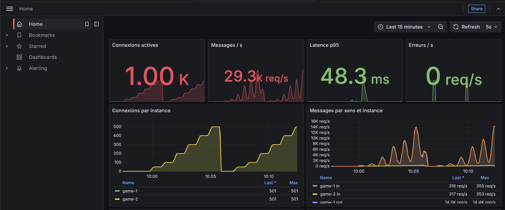
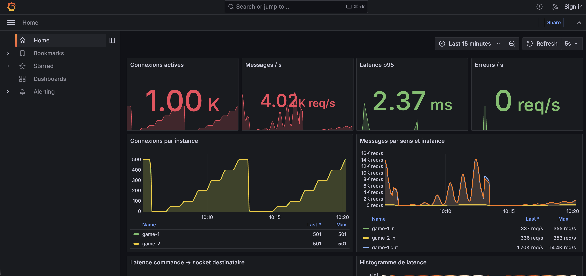
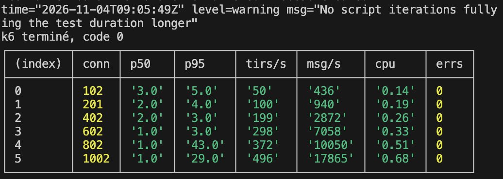
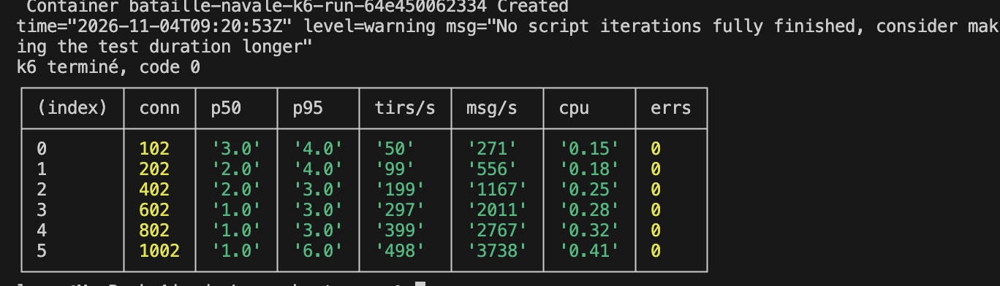

# Mesures : charge, observabilité et optimisation

Ce document couvre la phase 5 : le protocole de mesure, les résultats par palier, le seuil de dégradation et le gain de l'optimisation, mesuré avant et après avec la même méthode.

## 1. Protocole

### Machine et environnement

| Élément | Valeur |
|---|---|
| Machine | MacBook Air (M2, 2022), Apple M2 8 cœurs (4 performance, 4 efficience), 8 Go de mémoire unifiée |
| Exécution | Docker Desktop, pile complète de `docker-compose.yml` : nginx, `game-1`, `game-2`, Redis, Prometheus, Grafana |
| Générateur de charge | k6 0.54 (service `k6`, profil `load`), **sur la même machine** que la pile |
| Date | 4 novembre 2026, mesure « avant » terminée à 09:05:49 UTC, mesure « après » terminée à 09:20:53 UTC |
| Version du code | `main`, commit `942de76` *(à confirmer : dernier commit poussé avant la mesure)* |

### Scénario (`load/scenario.js`)

Chaque utilisateur virtuel (VU) est un **joueur complet**, pas un simple client qui envoie des messages :

1. il obtient un jeton par `POST /api/auth/guest`, puis ouvre une WebSocket authentifiée en passant par nginx ;
2. il entre dans la file d'appariement (`match.queue`) et reçoit un adversaire, un autre VU ;
3. il place une flotte fixe (`game.place`) ;
4. il tire sur une case au hasard toutes les 1 s ± 25 % quand c'est son tour, et rejoue après une touche ;
5. à la fin de la partie, il se remet en file 500 ms plus tard et enchaîne les parties ;
6. il envoie aussi un `sys.ping` toutes les 5 s.

Les joueurs sont simulés, ce qui est accepté par le socle commun. Aucune donnée externe n'est utilisée.

### Montée en charge

| Paramètre | Valeur |
|---|---|
| Paliers de connexions simultanées | 100, 200, 400, 600, 800, 1 000 |
| Montée vers chaque palier | 20 s, linéaire (`ramping-vus`) |
| Plateau | 40 s, dont les 5 premières sont ignorées pendant que les parties démarrent |
| Fenêtre mesurée | les 35 dernières secondes de chaque plateau |
| Durée d'un passage | 6 min 5 s environ |
| Répartition | nginx `least_conn` : 501 connexions par instance au dernier palier (voir les captures) |

### Point d'horodatage de la latence

La latence mesurée va **du tireur à l'adversaire**, de bout en bout :

- **départ** : le VU tireur place `clientTs = Date.now()` dans `game.fire`, juste avant l'envoi ;
- **arrivée** : le VU adverse relève `Date.now()` à la réception de `game.shot`, qui transporte `clientTs`.

Le trajet complet est compté : nginx, l'instance qui reçoit la commande, la validation, le script Lua sur Redis, Pub/Sub, l'instance de l'adversaire (souvent l'autre), puis l'écriture sur sa socket. Les deux VU tournent dans le même processus k6 : ils partagent la même horloge et aucun décalage d'horloge n'entre dans la mesure. Le temps de réflexion du joueur n'est pas compté.

Côté serveur, l'histogramme Prometheus `bn_event_latency_seconds` mesure en parallèle un trajet plus court : de la réception de la commande à l'écriture sur la socket du destinataire. C'est lui qu'affiche Grafana.

### Reproduire la mesure

```bash
docker compose up -d
node load/run.mjs avant 0     # sans optimisation : présence diffusée à chaque variation
node load/run.mjs apres 500   # avec optimisation : présence regroupée par fenêtres de 500 ms
```

`load/run.mjs` part toujours du même état : il vide Redis (`FLUSHALL`), recrée les deux instances avec la valeur de `PRESENCE_BATCH_MS` demandée et attend 8 s. Il lance ensuite k6, puis lit Prometheus sur les mêmes fenêtres que k6, alignées sur l'horloge de k6. Il écrit enfin `load/results/<étiquette>.json` et affiche le tableau reproduit plus bas. **La seule différence entre les deux passages est `PRESENCE_BATCH_MS`.**

## 2. Métriques et tableau de bord

| Métrique exposée (`/metrics`, une par instance) | Nom Prometheus |
|---|---|
| Connexions actives | `bn_ws_connections_active` |
| Messages par seconde, par sens et par type | `bn_ws_messages_total` (compteur, `rate()`) |
| Octets par seconde | `bn_ws_bytes_total` |
| Latence, en histogramme | `bn_event_latency_seconds` (seaux de 1 ms à 5 s) |
| Erreurs, par code | `bn_errors_total` |
| Déconnexions, par cause | `bn_ws_disconnects_total` |
| Poignées de main refusées | `bn_ws_rejected_upgrades_total` |
| Processus Node (CPU, boucle d'événements, mémoire) | `bn_node_*` |

Grafana (<http://localhost:3001>) ouvre directement le tableau de bord `bataille-navale`, généré par `scripts/gen-dashboard.mjs`. Il contient 11 panneaux : connexions, msg/s, p95, erreurs, connexions par instance, messages par sens et par instance, latence p50/p95/p99, heatmap de l'histogramme, erreurs par code, déconnexions par cause et refus.

## 3. Optimisation testée : regroupement de la présence

**Problème.** Chaque joueur voit la liste des commandants connectés et leur état (`lobby` ou `playing`). Sans regroupement, chaque variation (arrivée, départ, début ou fin de partie) est envoyée **immédiatement à toutes les connexions** de chaque instance. Avec N joueurs qui enchaînent des parties, le nombre de variations par seconde croît avec N, et chacune part vers N sockets : le coût croît comme N².

**Optimisation.** Chaque instance accumule les variations reçues pendant une fenêtre de `PRESENCE_BATCH_MS` (500 ms) et les fusionne : un joueur qui passe de `lobby` à `playing` puis revient ne compte qu'une fois. Elle envoie ensuite **un seul** `presence.delta` par connexion (`server/src/hub.js`, `mergePresence` et `flushPresence`). Avec `PRESENCE_BATCH_MS=0`, chaque variation part seule. C'est la mesure « avant ».

Le contrat de messages ne change pas : le client applique un `presence.delta` de la même façon, qu'il porte une variation ou cinquante. Le prix est un retard d'affichage de la présence de 500 ms au plus, compté dans le délai annoncé (`docs/garanties.md`).

## 4. Résultats

Les valeurs sont celles affichées par `load/run.mjs` à la fin de chaque passage (captures ci-dessous). La latence est la latence de bout en bout entre deux VU, en millisecondes. « msg/s » compte les messages WebSocket entrants et sortants des deux instances. « CPU » est la somme des deux instances, en cœurs.

### Avant : `PRESENCE_BATCH_MS=0`

| Connexions | p50 (ms) | p95 (ms) | Tirs/s | msg/s | CPU (cœurs) | Erreurs |
|---:|---:|---:|---:|---:|---:|---:|
| 102 | 3 | 5 | 50 | 436 | 0,14 | 0 |
| 201 | 2 | 4 | 100 | 940 | 0,19 | 0 |
| 402 | 2 | 3 | 199 | 2 872 | 0,26 | 0 |
| 602 | 1 | 3 | 298 | 7 058 | 0,33 | 0 |
| 802 | 1 | **43** | 372 | 10 050 | 0,51 | 0 |
| 1 002 | 1 | **29** | 496 | 17 865 | 0,68 | 0 |

### Après : `PRESENCE_BATCH_MS=500`

| Connexions | p50 (ms) | p95 (ms) | Tirs/s | msg/s | CPU (cœurs) | Erreurs |
|---:|---:|---:|---:|---:|---:|---:|
| 102 | 3 | 4 | 50 | 271 | 0,15 | 0 |
| 202 | 2 | 4 | 99 | 556 | 0,18 | 0 |
| 402 | 2 | 3 | 199 | 1 167 | 0,25 | 0 |
| 602 | 1 | 3 | 297 | 2 011 | 0,28 | 0 |
| 802 | 1 | 3 | 399 | 2 767 | 0,32 | 0 |
| 1 002 | 1 | 6 | 498 | 3 738 | 0,41 | 0 |

Aucune erreur applicative et aucune connexion perdue dans les deux passages : le nombre de connexions observé dans Prometheus correspond à la cible de chaque palier.

### Captures

| | Avant (`0`) | Après (`500`) |
|---|---|---|
| Tableau de bord Grafana |  |  |
| Sortie de `load/run.mjs` |  |  |

Dans Grafana, les deux passages sont visibles l'un après l'autre : l'escalier des connexions monte jusqu'à 501 par instance. Avant l'optimisation, la courbe des messages sortants atteint environ 14 000 msg/s **par instance** au palier de 1 000, et le panneau « Messages / s » atteint 29 300 msg/s au total en fin de montée. Après l'optimisation, la même courbe reste sous 2 000 msg/s par instance et le total s'affiche à 4 020 msg/s. Les messages entrants, qui sont les commandes des joueurs, sont les mêmes dans les deux cas : environ 340 msg/s par instance.

## 5. Interprétation

### Débit

Le débit utile, en **tirs par seconde**, est identique avant et après : 496 contre 498 au palier de 1 000. Il progresse linéairement, environ 0,5 tir/s par connexion, ce qui correspond au scénario (un tir par seconde, un joueur sur deux à son tour). La charge métier est donc la même dans les deux passages. Seul le coût de la diffusion change.

### Seuil de dégradation

- **Avant l'optimisation**, la latence se dégrade **entre 600 et 800 connexions** : le p95 passe de 3 ms à 43 ms, soit 14 fois plus. Il reste instable au palier suivant (29 ms à 1 000). Le p50 reste à 1 ms : la majorité des tirs passe vite, mais une partie attend derrière les rafales de présence. Le panneau « Latence p95 » de Grafana montre d'ailleurs un pic net pendant le passage « avant », absent du passage « après ».
- **Après l'optimisation**, il n'y a **pas de dégradation jusqu'à 1 000 connexions**, le plus haut palier mesuré : le p95 reste entre 3 et 6 ms. Le seuil se situe donc au-delà de 1 000 connexions sur cette machine.

Un relevé exploratoire antérieur est conservé dans `load/results/explore.json`. Il a été pris avec l'optimisation active, des paliers allant jusqu'à 2 000, sur le poste Windows du groupe (Ryzen 3 5300U, 8 Go) et avec une version précédente des règles. Il situait la dégradation entre 1 200 connexions (p95 de 125 ms) et 1 600 (p95 de 728 ms), puis un effondrement à 2 000 : boucle d'événements bloquée environ 2 s, déconnexions par battement manqué. Comme la machine et la version diffèrent, ce relevé **n'est pas comparable** aux deux mesures ci-dessus. Il donne seulement l'ordre de grandeur de la limite suivante.

### Gain chiffré, à méthode identique

| Indicateur au palier de 1 000 connexions | Avant | Après | Gain |
|---|---:|---:|---:|
| Messages WebSocket par seconde | 17 865 | 3 738 | **−79 %** (÷ 4,8) |
| Messages par connexion et par seconde | 17,8 | 3,7 | −79 % |
| CPU des deux instances | 0,68 cœur | 0,41 cœur | **−40 %** |
| Latence p95 | 29 ms | 6 ms | −79 % |
| Latence p95 à 800 connexions | 43 ms | 3 ms | −93 % |
| Tirs par seconde (charge utile) | 496 | 498 | identique |

Le gain grandit avec la charge, ce qui confirme que le coût évité est quadratique. Le nombre de messages est divisé par 1,6 à 100 connexions et par 4,8 à 1 000. Sans regroupement, multiplier les connexions par 10 multiplie les messages par 41. Avec regroupement, par 13,8 seulement.

## 6. Limites de la mesure

- **k6 tourne sur la même machine que la pile.** Il consomme du CPU et de la mémoire qui manquent au serveur : les chiffres sont pessimistes pour le serveur et ne valent que pour cette machine.
- **Un seul passage par configuration.** L'inversion du p95 entre 800 (43 ms) et 1 000 connexions (29 ms) montre que le p95 « avant » varie d'un palier à l'autre. Plusieurs passages donneraient un intervalle de confiance.
- **Le palier de 1 000 connexions n'a pas suffi à faire décrocher la version optimisée.** Pour trouver son seuil exact, il faut relancer avec `TIERS=1000,1200,1400,1600,1800 node load/run.mjs apres-haut 500`.
- **Les valeurs reprises ici sont celles de la console**, arrondies à la milliseconde. Les fichiers complets (`load/results/avant.json`, `load/results/apres.json` et `load/results/raw/`, avec p99, octets par seconde et retard de la boucle d'événements) restent sur la machine de mesure et doivent être ajoutés au dépôt.
- L'avertissement de k6 « No script iterations fully finished » est normal ici : chaque VU joue pendant tout le test dans une seule itération, qui ne se termine qu'à l'arrêt du scénario.
